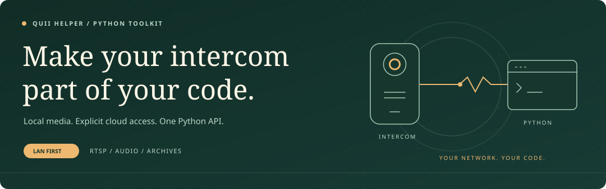

<p align="center"></p>

<h1 align="center">QUII Helper</h1>
<p align="center"><strong>Live video. Two-way audio. Your own integrations.</strong></p>
<p align="center">
  <a href="https://pypi.org/project/quii-helper/"></a>
  <a href="https://pypi.org/project/quii-helper/"></a>
  <a href="https://github.com/xaer981/quii-helper/blob/main/LICENSE"></a>
  <a href="https://boosty.to/xaer981"></a>
</p>
<p align="center"><a href="https://github.com/xaer981/quii-helper#get-started">Get started</a> &nbsp; / &nbsp; <a href="https://github.com/xaer981/quii-helper#choose-the-source">Cloud or LAN?</a> &nbsp; / &nbsp; <a href="https://github.com/xaer981/quii-helper/blob/main/docs/README.md">Documentation</a> &nbsp; / &nbsp; <a href="https://github.com/xaer981/quii-helper/issues">Community</a></p>

A Python library for QUII / Qualvision cameras and video intercoms, without
running the original mobile app. Start with the task, not a wall of settings.
Use local media by default; opt into cloud services only when you need them.

<a id="features-"></a>

## One Camera, Several Possibilities

**Watch and capture.** Local H.264 video, JPEG snapshots, MP4 recording and
RTSP for players such as VLC. RTSP audio is opt-in with `audio=True`;
MP4 includes supported G.711 audio as AAC, otherwise it stays video-only.

**Listen and talk.** Receive encoded audio or explicitly start two-way
conversation while video continues. `session.start_talk()` / `stop_talk()`
share the RTSP preview. Computer microphone/headphones use the optional
`audio` extra; caller-supplied PCM does not need it. No RTSP backchannel
or echo cancellation is provided; use headphones.

**Observe and integrate.** Archive JPEG/MP4 downloads, new archive entries,
device inspection, LAN discovery, cloud call history and explicit door control.

**LAN is the default.** A valid saved key/auth pair is reused without cloud
login, renewal or fallback. Loading JSON or constructing `Camera` performs no
cloud request. LAN-only describes this client's traffic, not the device's own
Internet access. Experimental APIs and feature coverage depend on firmware.

<a id="quick-start-"></a>

## Get Started

### 1 / Install

Use Python **3.10 or newer**, preferably in a virtual environment:

```shell
python -m pip install quii-helper
```

Upgrade with `python -m pip install --upgrade quii-helper`.
RTSP needs no FFmpeg; snapshot/MP4 rendering does.
See [installation and media prerequisites](https://github.com/xaer981/quii-helper/blob/main/docs/setup.md#using-an-installed-package).
Since **0.6.0**, the installed command provides an [offline LAN check](https://github.com/xaer981/quii-helper/blob/main/docs/setup.md#offline-lan-check)
and [LAN RTSP command](https://github.com/xaer981/quii-helper/blob/main/docs/setup.md#lan-rtsp-from-the-command-line).

### 2 / Choose Your Scenario

- **Local video, snapshots or clips:** reuse your saved pair in step 3.
  If you need a pair first, complete the explicit cloud bootstrap below.
- **Incoming-call history:** use [cloud history setup](https://github.com/xaer981/quii-helper/blob/main/docs/setup.md#cloud-call-history).
  Each query contacts cloud; no stream key or camera LAN IP is required.
- **New local archive pictures/videos:** use [local archive setup](https://github.com/xaer981/quii-helper/blob/main/docs/setup.md#local-archive-observations).
  The metadata API needs a LAN host and auth code, not a stream key or cloud login.

The media setup below is not a prerequisite for the other two scenarios.
For an existing application, pass configuration explicitly; see
[all constructor options](https://github.com/xaer981/quii-helper/blob/main/docs/api.md#constructor).

<a id="3-first-run-cloud-setup-and-key-save"></a>

<details>
<summary><strong>First time with media? Fetch and save a key through cloud</strong></summary>

**This is a separate cloud operation, not part of normal LAN startup.**
Fill all **10 required variables** in your application's `.env` before running
the bootstrap. Local IP/channel/stream settings alone cannot obtain a key.

```dotenv
CLOUD_ACCOUNT="<mobile-app-login>"
CLOUD_PASSWORD="<mobile-app-password>"
DEVICE_ID="<your-camera-device-id>"
CLOUD_CLIENT_UUID="<generate-once-with-command-below>"
CLOUD_AUTH_URL="<auth-url-for-your-app-and-region>"
CLOUD_SERVICE_URL="<service-discovery-base-url-from-your-app>"
CAMERA_OEM="<oem-from-your-app>"
CAMERA_APP_ID=<numeric-app-id>
CAMERA_CLIENT_TYPE=<numeric-client-type>
IP_REGION_ID=<numeric-region-id>
```

Replace every placeholder. The last three values must be positive integers
from your app/region. Generate `CLOUD_CLIENT_UUID` once, then keep it:

```shell
python -c "import uuid; print(uuid.uuid4().hex)"
```

Find the app values through [APK inspection](https://github.com/xaer981/quii-helper/blob/main/docs/setup.md#finding-apk-constants)
and, if needed, [cloud discovery](https://github.com/xaer981/quii-helper/blob/main/docs/setup.md#discovering-cloud-values).
`CLOUD_SERVICE_URL` is required by shared validation, although this bootstrap
does not perform discovery. `CLOUD_AUTH_VERSION` is additionally required
for a versioned auth header. TLS verification is enabled by default;
follow [TLS troubleshooting](https://github.com/xaer981/quii-helper/blob/main/docs/setup.md#cloud-region-and-auth-url)
if a vendor certificate fails.

With these settings already known, bootstrap needs **no camera IP, APK
assets, FFmpeg, `AUTH_CODE` or `STREAM_KEY`**. Discovery is a separate operation
with its own assets. Run this once from your application directory:

```python
from quii_helper import Camera, load_config

cloud_camera = Camera(config=load_config(), connection_mode="cloud")
credentials = cloud_camera.fetch_stream_credentials()
credentials.save("data/stream_credentials.json")
```

Resolve any failure before proceeding. Re-running this code contacts cloud
again and replaces the file; it does not edit `.env`, start preview or open a
door. Keep this code out of normal LAN startup. The saved file is private.

</details>

<a id="4-later-runs-lan-only-playback"></a>
<a id="rtsp-streaming-"></a>

### 3 / Start A Local Stream

Keep `data/stream_credentials.json` for this camera. Put the local settings
below in `.env`, replacing the example IP:

```dotenv
CAMERA_CONNECTION_MODE=lan
CAMERA_DEVICE_HOST=192.0.2.10
CAMERA_STREAM_PORT=34567
CAMERA_CHANNEL=1
CAMERA_STREAM=low
```

Choose the panel with `CAMERA_CHANNEL`. Use `CAMERA_STREAM=high` (`1`) for
the main stream or `low` (`2`) for lower bandwidth; exact resolution and
other ids depend on firmware. Explicit `Camera(..., stream_quality="high")`
overrides the configured choice. These are separate from advanced protocol
compatibility options; see [stream settings](https://github.com/xaer981/quii-helper/blob/main/docs/setup.md#what-your-operation-needs).

With **0.6.0 or newer**, run this from your application directory (the one
with `.env`):

```shell
quii-helper rtsp --credentials data/stream_credentials.json
```

Open the URL printed after `RTSP stream ready` in VLC. Press Ctrl+C to stop.
The command uses LAN only and never fetches or renews the saved key. For viewing
from another computer, see the [SSH tunnel setup](https://github.com/xaer981/quii-helper/blob/main/docs/setup.md#watch-from-another-computer).

On an older version, upgrade with `python -m pip install --upgrade quii-helper`
or use the Python example below.

<details>
<summary><strong>Use the Python API instead</strong></summary>

Run this from the same application directory. Keep the cloud bootstrap code
out of this script: this example forces LAN mode and reuses the saved pair.

```python
from quii_helper import Camera, CameraStreamCredentials, load_config

saved = CameraStreamCredentials.load("data/stream_credentials.json")
camera = Camera(
    config=load_config(),
    connection_mode="lan",
    device_id=saved.device_id,
    stream_key=saved.stream_key,
    auth_code=saved.auth_code,
    status=print,
)

try:
    with camera.serve_rtsp(port=8554) as session:
        session.wait()
except KeyboardInterrupt:
    pass
```

Open the printed URL in VLC after `RTSP stream ready`. The context manager
closes the session on Ctrl+C, and `wait()` propagates background failures.
For a trusted LAN, the Python API can explicitly bind
`host="0.0.0.0"` and connect to the server's LAN IP, not `0.0.0.0`.

For JPEG/MP4, install FFmpeg and use `camera.snapshot()` or
`camera.save_video(duration_seconds=15)`. Both return a `pathlib.Path`;
default outputs go to `./data/`. See [capture parameters](https://github.com/xaer981/quii-helper/blob/main/docs/api.md#capture-methods)
for timeouts and rendering overhead.

</details>

RTSP has **no authentication or TLS**: never expose the port publicly.
Saved keys may stop working: check connectivity and settings, then explicitly
repeat bootstrap if needed.
Their lifetime is not guaranteed; timeouts do not renew credentials.

## Choose The Source

**Cloud and LAN are different tools, not automatic fallbacks.**

| Operation | Network path | What it means |
| --- | --- | --- |
| Saved-key media and talk in LAN mode | Local device | No cloud requests. Talk is explicitly activated. |
| `fetch_stream_credentials()` | Vendor cloud | Explicit bootstrap; saving the returned pair is a separate action. |
| `get_cloud_call_events()` / `get_call_events()` | Vendor cloud | Incoming-call history, not a live ringing subscription. |
| `watch_archive_events()` / `list_record_files()` | Local CGI | New archive pictures/videos; no preview or stream key is needed by the metadata API. |
| Local CGI inspection and `open_door()` | Local device | The opening command is active. Auto mode may first look up an unknown capability in explicit cloud mode; LAN mode requires it already known. |

`connection_mode="cloud"` permits cloud methods and selects cloud/P2P media;
it **does not reroute local CGI requests through cloud**. Cloud/P2P media
does not require a manually supplied LAN IP; local CGI does.

### Cloud Call History

Since **0.5.0**, `get_cloud_call_events()` is the explicit cloud name;
`get_call_events()` remains the same method for backward compatibility.
Each query authenticates; tokenless alarm login may create an isolated reader
session, without push registration or marking records read.
See [cloud setup and limits](https://github.com/xaer981/quii-helper/blob/main/docs/setup.md#cloud-call-history).
The polling example checks the first 15 rows every five seconds for three
minutes. It remembers the first successful page, then prints unseen rows;
delayed history and bursts can be missed or detected late.

### Local Archive Observations

Use **0.5.1 or newer** for archive observation fixes. Upgrade with
`python -m pip install --upgrade "quii-helper>=0.5.1"`.

`watch_archive_events()` polls metadata every five seconds for three minutes
by default. The default `file_type="all"` combines
fresh `video` and `picture` searches each poll; either failing or incomplete
search stops observation. The first complete batch is the baseline; later
identities are deduplicated. Errors are not empty results.
The bundled example reuses the RTSP credential JSON and asks for the monitor's
current time; invalid input can be retried and Ctrl+C cancels the prompt.

> Archive entries are **not confirmed calls**. Coverage depends on the device's
> picture/video-on-call setting and usable storage. `manual` can describe
> a ring recording or a manual monitor recording. Tested Tantos video appeared
> after recording ended; photo-on-call latency has not been tested.
> Do not open a door automatically based on archive entries alone.

See [local setup, direct-auth usage and bounds](https://github.com/xaer981/quii-helper/blob/main/docs/setup.md#local-archive-observations).
No cloud key refresh, preview, downloads or door commands are started by this
watcher. The time budget stops new polls, not an in-flight poll batch.

## Start With An Example

Examples require a configured checkout or source distribution; the wheel
installs the library, not `examples/`. Run them from the checkout root.

| Goal | Command / guide |
| --- | --- |
| Fetch/save a pair, then view locally | `python -m examples.cloud_key_rtsp` (contacts cloud first on every run) |
| View with a saved pair, without cloud | `python -m examples.lan_rtsp` |
| Read one cloud history page | `python -m examples.call_events` |
| Poll cloud history | `python -m examples.watch_call_events` |
| Observe local archive additions | `python -m examples.watch_archive_events` |
| Talk while watching video | [Shared-preview conversation](https://github.com/xaer981/quii-helper/blob/main/docs/api.md#computer-conversation-experimental) |
| Download archived pictures or video | [Archive API and protocol variants](https://github.com/xaer981/quii-helper/blob/main/docs/api.md#archive-queries) |

<a id="compatibility-"></a>

## Tested In The Real World

- **Tantos Marilyn Wi-Fi s / vHome 2.2:** tested LAN media, audio/talk,
  archived video, cloud history and explicit door opening; Raspberry Pi
  ARM64 playback and file-backed speech/reply were also checked.
- **Vimar K40955 / vEye Pro 1.9.4.0.2:** community-confirmed LAN RTSP;
  observed 352x288 / about 20 FPS, with unresolved audio. No blanket
  high-resolution/talk claim.
- **Intelbras Allo wT7 / Allo Plus:** community reports for IDS9478AW and
  IDS94B1W, with different operation coverage. Archive JPEG downloads on
  IDS94B1W use explicit `protocol="pipelined"` and additional credentials.

[Read exact models, firmware, workarounds and validation scope](https://github.com/xaer981/quii-helper/blob/main/COMPATIBILITY.md).
The header `Server: Qualvision -HTTPServer` and TCP port `34567` can help
identify related devices, but do not prove support. A working video stream
does not establish support for door control, talk or call history.
Physical computer duplex quality and Vimar audio/talk remain unverified.

<a id="documentation-"></a>

## Make It Yours

[Setup](https://github.com/xaer981/quii-helper/blob/main/docs/setup.md) / [API reference](https://github.com/xaer981/quii-helper/blob/main/docs/api.md) / [Changelog](https://github.com/xaer981/quii-helper/blob/main/CHANGELOG.md) / [Security](https://github.com/xaer981/quii-helper/blob/main/SECURITY.md) / [Contributing](https://github.com/xaer981/quii-helper/blob/main/CONTRIBUTING.md)

Built an integration or tried another device? [Share a report](https://github.com/xaer981/quii-helper/issues).
The library is pre-`1.0`; experimental APIs remain firmware-dependent.

<a id="safety-and-limitations-"></a>

### Safety And Limits

Keep credentials and private media out of reports and version control.
TLS verification stays enabled by default; follow [TLS troubleshooting](https://github.com/xaer981/quii-helper/blob/main/docs/setup.md#cloud-region-and-auth-url)
for vendor certificate issues. Do not run opening/talk commands as installation
tests: they have physical effects, and acceptance does not prove the outcome.
An uncertain opening command must not be retried automatically.
Review the [security policy](https://github.com/xaer981/quii-helper/blob/main/SECURITY.md)
before exposing an integration.

### Support The Project

**Free, open source, MIT.** [Support development on Boosty](https://boosty.to/xaer981)
if the project helps you. Donations are optional and do not purchase priority
or delivery dates. Bug reports and device testing are equally welcome.

<p align="center"><a href="https://github.com/xaer981"></a></p>
