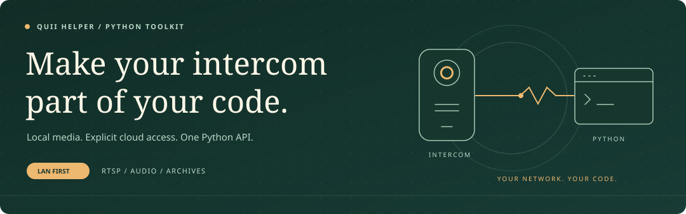

<p align="center"></p>

<h1 align="center">QUII Helper</h1>
<p align="center"><strong>Live video. Two-way audio. Your own integrations.</strong></p>
<p align="center">
  <a href="https://pypi.org/project/quii-helper/"></a>
  <a href="https://pypi.org/project/quii-helper/"></a>
  <a href="https://github.com/xaer981/quii-helper/blob/main/LICENSE"></a>
  <a href="https://boosty.to/xaer981"></a>
</p>
<p align="center"><a href="https://github.com/xaer981/quii-helper#get-started">Get started</a> &nbsp; / &nbsp; <a href="https://github.com/xaer981/quii-helper/blob/main/docs/archive-cli.md">Archive CLI</a> &nbsp; / &nbsp; <a href="https://github.com/xaer981/quii-helper/blob/main/COMPATIBILITY.md">Compatibility</a> &nbsp; / &nbsp; <a href="https://github.com/xaer981/quii-helper/blob/main/docs/README.md">Documentation</a></p>

A Python library and command-line tool for QUII / Qualvision cameras and
video intercoms. View and save media on your LAN without running the original
mobile app. Contact the vendor cloud explicitly to obtain a key or read call history.

<a id="features-"></a>

## One Camera, Several Possibilities

- **Watch and capture:** RTSP for VLC, JPEG snapshots and MP4 recording.
  RTSP audio is opt-in; MP4 includes audio when the stream supplies supported G.711.
- **Listen and talk:** receive audio or start a two-way conversation on the
  same preview with the [Python API](https://github.com/xaer981/quii-helper/blob/main/docs/api.md#computer-conversation-experimental).
- **Browse and integrate:** list or download archived JPEG/MP4 in the terminal
  or from a script. The API also provides archive observation, device inspection,
  LAN discovery, cloud call history and explicit door control.

<a id="quick-start-"></a>

## Get Started

### 1 / Install

Use Python **3.10 or newer**, preferably in a virtual environment:

```shell
python -m pip install --upgrade quii-helper
```

Run `quii-helper --help` to see the installed commands. RTSP does not need
FFmpeg; JPEG snapshots and MP4 rendering do. See
[installation and optional dependencies](https://github.com/xaer981/quii-helper/blob/main/docs/setup.md#using-an-installed-package).

### 2 / Choose Your Scenario

| Goal | Start here |
| --- | --- |
| Watch live video or capture a clip | [Start a local stream](https://github.com/xaer981/quii-helper#3--start-a-local-stream) with a saved key/auth pair. If you need a pair, open the cloud bootstrap below. |
| Browse or download saved files | [Archive CLI](https://github.com/xaer981/quii-helper/blob/main/docs/archive-cli.md). Listing needs local CGI auth; downloads also need the stream key. |
| Read incoming-call history | [Cloud history setup](https://github.com/xaer981/quii-helper/blob/main/docs/setup.md#cloud-call-history). No camera IP or stream key is needed. |
| Observe new archive entries | [Local archive setup](https://github.com/xaer981/quii-helper/blob/main/docs/setup.md#local-archive-observations). This is not a live call notification. |

<a id="3-first-run-cloud-setup-and-key-save"></a>

<details>
<summary><strong>First time with media? Fetch and save a key through cloud</strong></summary>

**This is a separate cloud operation, not part of normal LAN startup.**
Fill all **10 required variables** in your application's `.env` before running
the bootstrap. Local IP/channel/stream settings alone cannot obtain a key.

```dotenv
CLOUD_ACCOUNT="<mobile-app-login>"
CLOUD_PASSWORD="<mobile-app-password>"
DEVICE_ID="<your-camera-device-id>"
CLOUD_CLIENT_UUID="<generate-once-with-command-below>"
CLOUD_AUTH_URL="<auth-url-for-your-app-and-region>"
CLOUD_SERVICE_URL="<service-discovery-base-url-from-your-app>"
CAMERA_OEM="<oem-from-your-app>"
CAMERA_APP_ID=<numeric-app-id>
CAMERA_CLIENT_TYPE=<numeric-client-type>
IP_REGION_ID=<numeric-region-id>
```

Replace every placeholder. The last three values must be positive integers
from your app/region. Generate `CLOUD_CLIENT_UUID` once, then keep it:

```shell
python -c "import uuid; print(uuid.uuid4().hex)"
```

Find the app values through [APK inspection](https://github.com/xaer981/quii-helper/blob/main/docs/setup.md#finding-apk-constants)
and, if needed, [cloud discovery](https://github.com/xaer981/quii-helper/blob/main/docs/setup.md#discovering-cloud-values).
`CLOUD_SERVICE_URL` is required by shared validation, although this bootstrap
does not perform discovery. `CLOUD_AUTH_VERSION` is additionally required
for a versioned auth header. TLS verification is enabled by default;
follow [TLS troubleshooting](https://github.com/xaer981/quii-helper/blob/main/docs/setup.md#cloud-region-and-auth-url)
if a vendor certificate fails.

With these settings already known, bootstrap needs **no camera IP, APK
assets, FFmpeg, `AUTH_CODE` or `STREAM_KEY`**. Discovery is a separate operation
with its own assets. Run the installed bootstrap command from
your application directory:

```shell
quii-helper bootstrap --output data/stream_credentials.json
```

The command contacts cloud only when explicitly invoked. It refuses an
existing file **before cloud login**; deliberate replacement requires
`--overwrite`. It never starts preview or changes `.env`. See
[bootstrap options and errors](https://github.com/xaer981/quii-helper/blob/main/docs/setup.md#cloud-bootstrap-command).

**Python API alternative:**

```python
from quii_helper import Camera, load_config

cloud_camera = Camera(config=load_config(), connection_mode="cloud")
credentials = cloud_camera.fetch_stream_credentials()
credentials.save("data/stream_credentials.json")
```

Resolve any failure before proceeding. Re-running this Python code contacts cloud
again and replaces the file; it does not edit `.env`, start preview or open a
door. Keep this code out of normal LAN startup. The saved file is private.

</details>

<a id="4-later-runs-lan-only-playback"></a>
<a id="rtsp-streaming-"></a>

### 3 / Start A Local Stream

Keep `data/stream_credentials.json` for this camera. Put the local settings
below in `.env`, replacing the example IP:

```dotenv
CAMERA_CONNECTION_MODE=lan
CAMERA_DEVICE_HOST=192.0.2.10
CAMERA_STREAM_PORT=34567
CAMERA_CHANNEL=1
CAMERA_STREAM=low
```

Choose the panel with `CAMERA_CHANNEL` and quality with `CAMERA_STREAM`:
`high` selects the main stream (`1`), and `low` uses less bandwidth (`2`).
Actual resolution depends on firmware. From the same directory as `.env`:

```shell
quii-helper doctor --credentials data/stream_credentials.json
quii-helper rtsp --credentials data/stream_credentials.json
```

`doctor` checks configuration offline. Open the URL printed after
`RTSP stream ready` in VLC, then press Ctrl+C to stop. For another computer,
use an [SSH tunnel](https://github.com/xaer981/quii-helper/blob/main/docs/setup.md#watch-from-another-computer).
Add `--reconnect` to opt into
[recovery on the same RTSP URL](https://github.com/xaer981/quii-helper/blob/main/docs/setup.md#optional-lan-rtsp-recovery).

<details>
<summary><strong>Use the Python API instead</strong></summary>

Run this from the same application directory. Keep the cloud bootstrap code
out of this script: this example forces LAN mode and reuses the saved pair.

```python
from quii_helper import Camera, CameraStreamCredentials, load_config

saved = CameraStreamCredentials.load("data/stream_credentials.json")
camera = Camera(
    config=load_config(),
    connection_mode="lan",
    device_id=saved.device_id,
    stream_key=saved.stream_key,
    auth_code=saved.auth_code,
    status=print,
)

try:
    with camera.serve_rtsp(port=8554) as session:
        session.wait()
except KeyboardInterrupt:
    pass
```

Open the printed URL in VLC after `RTSP stream ready`. The context manager
closes the session on Ctrl+C, and `wait()` propagates background failures.
For a trusted LAN, the Python API can explicitly bind
`host="0.0.0.0"` and connect to the server's LAN IP, not `0.0.0.0`.

For JPEG/MP4, install FFmpeg and use `camera.snapshot()` or
`camera.save_video(duration_seconds=15)`. Both return a `pathlib.Path`;
default outputs go to `./data/`. See [capture parameters](https://github.com/xaer981/quii-helper/blob/main/docs/api.md#capture-methods)
for timeouts and rendering overhead.

</details>

RTSP has **no authentication or TLS**: never expose the port publicly.
LAN playback never logs in to cloud or renews the saved key. If the key stops
working, check connectivity and settings before repeating bootstrap.

## Choose The Source

- **LAN:** live media, talk and archive downloads reuse a saved key/auth pair.
  Archive listing and observation use local CGI auth and do not need the key.
- **Vendor cloud:** explicitly use bootstrap to obtain a pair or the cloud
  API to read call history. Nothing switches to cloud automatically.
- **Door control:** the open command goes to the local device. To select
  the password format in auto mode, see the [capability requirements](https://github.com/xaer981/quii-helper/blob/main/docs/api.md#door-control).

`connection_mode="cloud"` selects cloud/P2P preview; it does not reroute
local CGI through cloud. LAN-only describes this client's traffic, not the
device's Internet access.

### Cloud Call History

`get_cloud_call_events()` reads incoming-call history from the vendor cloud.
It does not subscribe to live calls, register push notifications or mark
records read. See [setup, polling example and limits](https://github.com/xaer981/quii-helper/blob/main/docs/setup.md#cloud-call-history).

### Local Archive Observations

`watch_archive_events()` polls local metadata and emits new entries after its
first complete scan. Archival time bounds use the device's clock. See
[setup and limits](https://github.com/xaer981/quii-helper/blob/main/docs/setup.md#local-archive-observations)
or the [archive CLI](https://github.com/xaer981/quii-helper/blob/main/docs/archive-cli.md)
for one-time searches and downloads.

> Archive entries are **not confirmed calls**. Coverage depends on the device's
> picture/video-on-call setting and usable storage. `manual` can describe
> a ring recording or a manual monitor recording. Tested Tantos video appeared
> after recording ended; photo-on-call latency has not been tested.
> Do not open a door automatically based on archive entries alone.

## Start With An Example

The quick-start commands above work from the installed wheel. To run these
Python examples, use a configured checkout or extracted source distribution:

- **LAN playback:** `python -m examples.lan_rtsp` reuses a saved pair.
- **Cloud bootstrap + playback:** `python -m examples.cloud_key_rtsp` contacts
  cloud first on every run.
- **Call history:** `python -m examples.call_events` reads one cloud page;
  `python -m examples.watch_call_events` polls for updates.
- **Local archive additions:** `python -m examples.watch_archive_events`.

See [all examples](https://github.com/xaer981/quii-helper/blob/main/docs/api.md#application-entry-point),
including [shared-preview conversation](https://github.com/xaer981/quii-helper/blob/main/docs/api.md#computer-conversation-experimental)
and [archive downloads from Python](https://github.com/xaer981/quii-helper/blob/main/docs/api.md#archive-queries).

<a id="compatibility-"></a>

## Tested In The Real World

- **Tantos Marilyn Wi-Fi s / vHome 2.2:** tested LAN media, audio/talk,
  archived video, cloud history and explicit door opening; Raspberry Pi
  ARM64 playback and file-backed speech/reply were also checked.
- **Vimar K40955 / vEye Pro 1.9.4.0.2:** community-confirmed LAN RTSP;
  observed 352x288 / about 20 FPS, with unresolved audio. No blanket
  high-resolution/talk claim.
- **Intelbras Allo wT7 / Allo Plus:** community reports for IDS9478AW and
  IDS94B1W, with different operation coverage. Archive JPEG downloads on
  IDS94B1W use explicit `protocol="pipelined"` and additional credentials.

[Read exact models, firmware, workarounds and validation scope](https://github.com/xaer981/quii-helper/blob/main/COMPATIBILITY.md).
The header `Server: Qualvision -HTTPServer` and TCP port `34567` can help
identify related devices, but do not prove support. A working video stream
does not establish support for door control, talk or call history.
Physical computer duplex quality and Vimar audio/talk remain unverified.

<a id="documentation-"></a>

## Make It Yours

[Setup](https://github.com/xaer981/quii-helper/blob/main/docs/setup.md) / [API reference](https://github.com/xaer981/quii-helper/blob/main/docs/api.md) / [Changelog](https://github.com/xaer981/quii-helper/blob/main/CHANGELOG.md) / [Security](https://github.com/xaer981/quii-helper/blob/main/SECURITY.md) / [Contributing](https://github.com/xaer981/quii-helper/blob/main/CONTRIBUTING.md)

Built an integration or tried another device? [Share a report](https://github.com/xaer981/quii-helper/issues).
The library is pre-`1.0`; experimental APIs remain firmware-dependent.

<a id="safety-and-limitations-"></a>

### Safety And Limits

Keep credentials and private media out of reports and version control.
TLS verification stays enabled by default; follow [TLS troubleshooting](https://github.com/xaer981/quii-helper/blob/main/docs/setup.md#cloud-region-and-auth-url)
for vendor certificate issues. Do not run opening/talk commands as installation
tests: they have physical effects, and acceptance does not prove the outcome.
An uncertain opening command must not be retried automatically.
Review the [security policy](https://github.com/xaer981/quii-helper/blob/main/SECURITY.md)
before exposing an integration.

### Support The Project

**Free, open source, MIT.** [Support development on Boosty](https://boosty.to/xaer981)
if the project helps you. Donations are optional and do not purchase priority
or delivery dates. Bug reports and device testing are equally welcome.

<p align="center"><a href="https://github.com/xaer981"></a></p>
